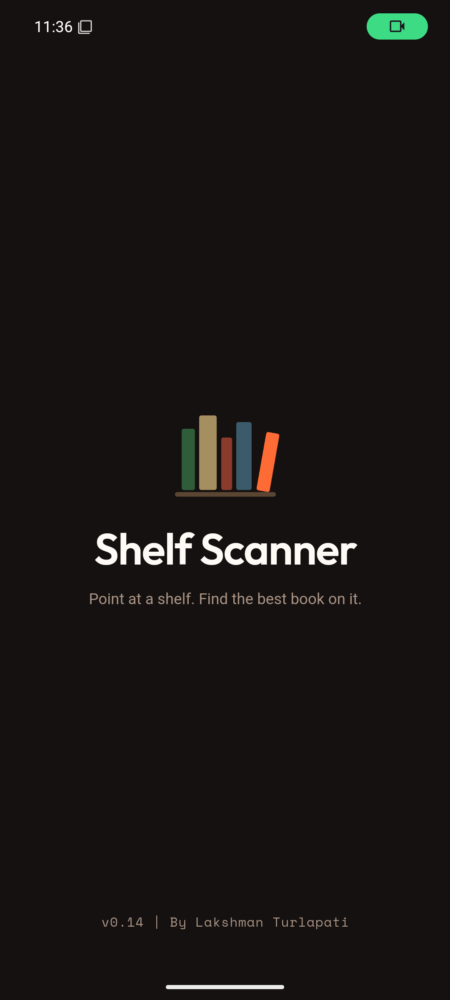
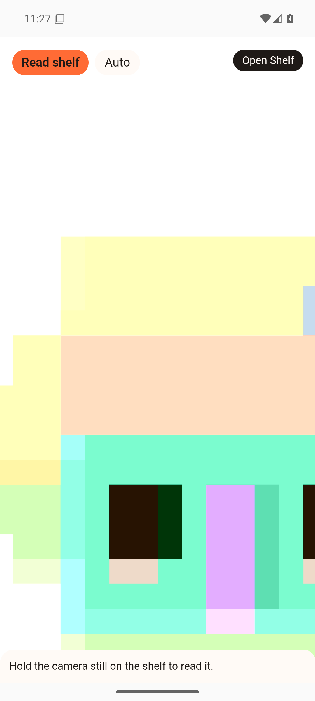
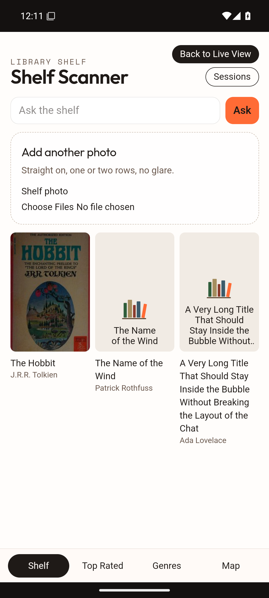
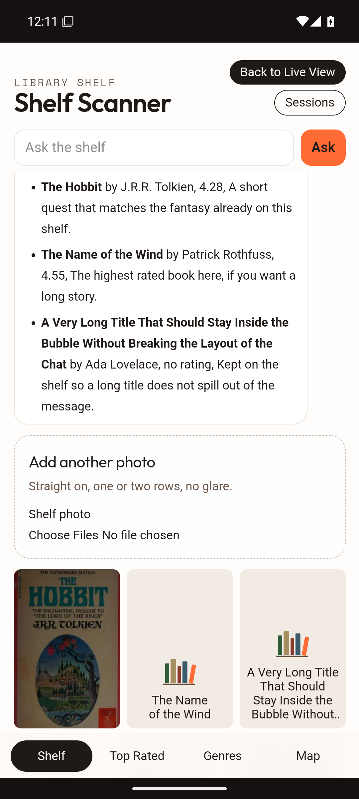
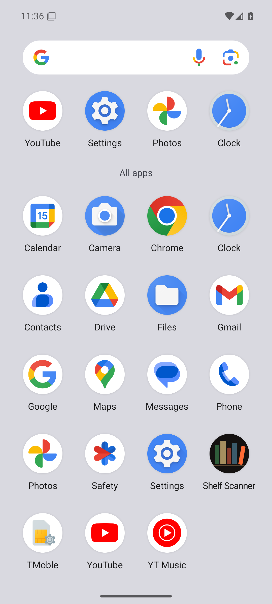

# Shelf Scanner

<div align="center">


**Point a camera at a shelf. See the titles, the ratings, and the book that fits you.**

[Features](#features) · [Screenshots](#screenshots) · [Android](#android-app) · [Setup](#local-setup) · [Tests](#tests) · [Deploy](#deploy-to-fly)

</div>

---

## Overview

Shelf Scanner reads a bookshelf from the camera. Titles stay on their spines while you move. A read looks up Goodreads ratings, and the same books land in a cover grid in the order you walked the shelf. A short quiz stays on the phone and marks a match as For you. Ask the shelf answers from the books in the current session.

The Android app is that same web app inside a Capacitor WebView. Reading and lookups go to [shelf-scanner.fly.dev](https://shelf-scanner.fly.dev). The taste profile never leaves the phone.

## Features

- **Live spine labels.** The camera tracks the shelf and keeps each title on its spine.
- **Goodreads ratings.** When Goodreads has a rating, the read shows it with the book.
- **Walk the shelf.** One session keeps the books in walk order. The cover grid uses that same order.
- **For you.** A saved genre, or the title you preferred in the quiz, highlights the matching live label and the matching cover.
- **Ask the shelf.** A question about the current session streams back as a short Markdown list: title, author, rating, and one line on why.

The shelf page also sorts the session into Top Rated, Genres, and a Map.

## Repository layout

| Path | Purpose |
|------|---------|
| [`web/`](web/) | React app: camera, labels, cover grid, quiz, and Ask the shelf. |
| [`server/`](server/) | Hono API: spine reads, Goodreads, cover ids, and Ask the shelf. |
| [`shared/`](shared/) | Types and schemas shared by the app and the server. |
| [`android/`](android/) | Capacitor project, launcher icons, and the release build. |
| [`scripts/`](scripts/) | Brand art and small build helpers. |
| [`tests/`](tests/) | Vitest and Playwright. |
| [`eval/`](eval/) | Offline benches for reads and tracking. |
| [`docs/`](docs/) | Screenshots used in this README. |

Root commands live in `package.json`. `vite.config.ts` builds the web app, `tsup.config.ts` builds the server, and `capacitor.config.ts` points the Android package at `dist/web`.

## Screenshots

<table>
<tr>
<td width="50%" align="center">

<br/><sub><b>Splash</b></sub>
</td>
<td width="50%" align="center">

<br/><sub><b>Live view</b></sub>
</td>
</tr>
<tr>
<td width="50%" align="center">

<br/><sub><b>Cover grid</b></sub>
</td>
<td width="50%" align="center">

<br/><sub><b>Ask the shelf</b></sub>
</td>
</tr>
<tr>
<td width="50%" align="center">

<br/><sub><b>Launcher</b></sub>
</td>
<td></td>
</tr>
</table>

These frames are from an Android 15 emulator. The live view is the emulator camera, not a photographed bookshelf. The cover grid and the answer use a seeded shelf, so a found cover, a missing cover, and a formatted answer are visible.

## Android app

The package is `app.shelfscanner.phone`, version 0.14.2 (versionCode 3). The label is Shelf Scanner.

A debug APK is enough to sideload. You need Node 24, the Android SDK, and a device or emulator with USB debugging:

```bash
npm run android:debug
adb install -r android/app/build/outputs/apk/debug/app-debug.apk
```

The live camera is `getUserMedia` inside the WebView. Packaged API calls go to the Fly app. Ask the shelf is the exception: a small native plugin reads that stream, because the usual Capacitor HTTP client waits for the whole body.

APK and AAB files are build outputs. They are not committed.

The privacy policy is [`PRIVACY.md`](PRIVACY.md). Its GitHub address on `main`, <https://github.com/LakshmanTurlapati/ShelfScanner/blob/main/PRIVACY.md>, is the one for the Play Console, and the app links to it from the camera notice and the Sessions panel. Keep it in step with what the app sends. If that changes, also update the notice in `web/src/DataNotice.tsx` and bump `DATA_NOTICE_VERSION` in `web/src/legal.ts`, so everyone sees it again.

Before the camera first opens, the app shows a one-time notice that pictures go to the server and to third-party AI models, and that some frames are kept. Ask the shelf answers carry a Report this answer control. Reports land on the server, and `npm run reports:pull` prints them.

### Play listing art

`npm run store:assets` writes `docs/store/feature-graphic.png` (1024×500) and three 1080×1920 phone screenshots. It captures the real UI with a demo shelf of public domain classics; their ratings are rounded demo values. The live camera needs a real shelf, so take that capture on a phone and frame it the same way:

```bash
npm run store:assets -- --frame ~/Desktop/live.png "Point at a shelf. Titles stay on their spines."
```

## Architecture

| Piece | What it does |
|-------|----------------|
| Camera and tracker | The web app watches the shelf and places labels from the homography. |
| Reads | `POST /api/read-strip` sends a JPEG. The server asks a model for the spines, then looks up Goodreads. |
| Covers | The server tries an ISBN, then a title and author, on Open Library and then Google Books. It caches the id or an https image address. It does not proxy the image bytes. A miss, a slow lookup, a failed image, or Open Library's one pixel stand in falls back to the shelf mark. |
| Ask the shelf | `POST /api/ask` streams Markdown. The page renders finished lines as a chat bubble and keeps a half written line as text until it closes. |
| Profile | The quiz is stored in IndexedDB on the phone. It is not sent to the API and it is not stored inside a scan session. |

## Local setup

Node 24 or newer.

```bash
npm install
cp .env.example .env
```

Put your OpenRouter key in `.env`. Reads and Ask the shelf need `OPENROUTER_API_KEY`. The example file also sets `APP_URL`, `CACHE_PATH`, and `PORT`.

```bash
npm run dev
```

That starts the Vite app and the API together. The web app is at `http://localhost:5173` and calls the API on the same origin.

Useful scripts:

```bash
npm run dev          # web app and API
npm run build        # production web build and server bundle
npm run start        # serve the built server
npm run lint         # TypeScript check
npm test             # Vitest
npm run test:e2e     # Playwright
npm run icons        # regenerate the shelf mark assets
npm run android:debug
npm run android:release
```

## Tests

```bash
npm run lint
npm test
npm run test:e2e
```

Android lint and a debug build:

```bash
cd android && ./gradlew lint assembleDebug
```

Playwright covers the browser and a phone sized Chrome project. Vitest covers the read pipeline, the profile match, the cover grid, and the Android shell.

## Deploy to Fly

The Fly app is `shelf-scanner`. `fly.toml` sets the region, the port, the health check, and a volume mounted at `/data` for the cover cache.

```bash
fly secrets set OPENROUTER_API_KEY=your_key
fly deploy
```

`GET /healthz` returns `ok`.

## Android release signing

Release builds turn on R8 and resource shrinking. Signing reads the environment, or an untracked `android/keystore.properties`. Never commit a keystore or a password.

| Variable | Meaning |
|----------|---------|
| `SHELF_KEYSTORE` | Path to the `.jks` or `.keystore` file |
| `SHELF_KEYSTORE_PASSWORD` | Store password |
| `SHELF_KEY_ALIAS` | Key alias |
| `SHELF_KEY_PASSWORD` | Key password |

`android/keystore.properties` uses `storeFile`, `storePassword`, `keyAlias`, and `keyPassword` when the environment variables are unset.

```bash
npm run android:release
```

That writes a release APK and an AAB under `android/app/build/outputs/`. Play Store upload needs a key you create and keep. A key made only to sideload a test build is not that key.

## License

This repository does not include a license file. Rights stay with the author until one is added.

<div align="center">

**Made by [Lakshman Turlapati](https://github.com/LakshmanTurlapati)**

</div>
